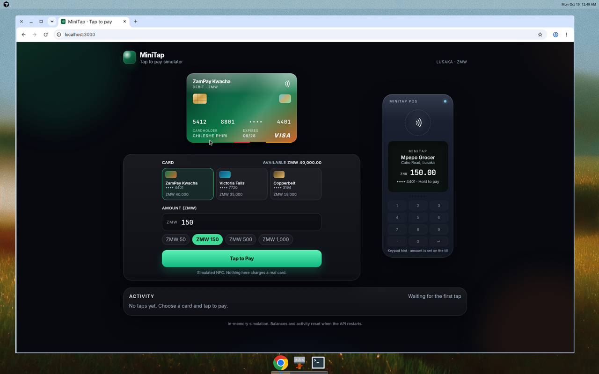
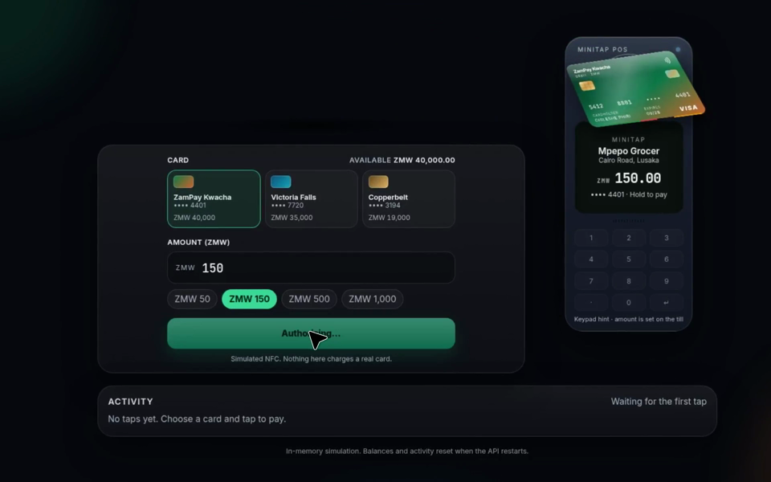
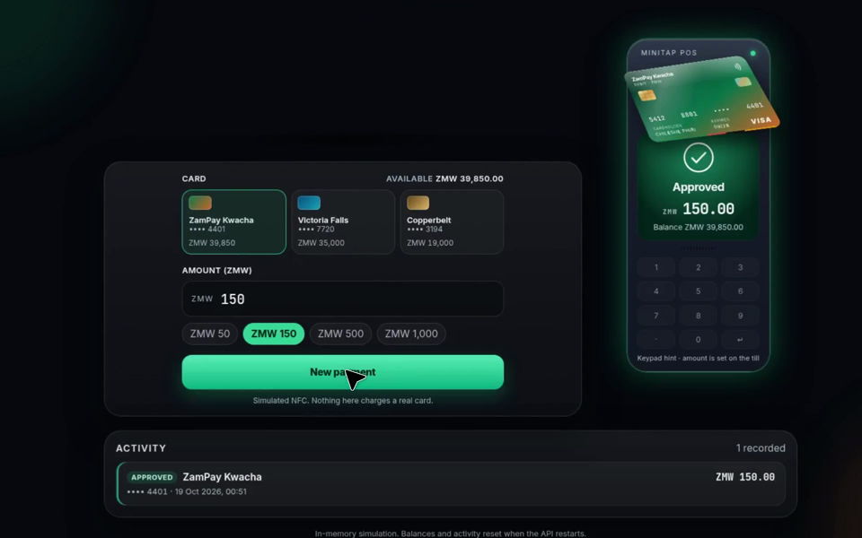
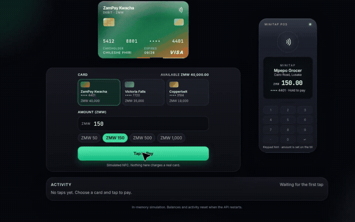

# MiniTap NFC Simulator

[](LICENSE)
[](https://github.com/AndrewDauti/minitap-nfc-sim/commits/main)
[](https://github.com/AndrewDauti/minitap-nfc-sim/issues)
[](https://github.com/AndrewDauti/minitap-nfc-sim)

A tap-to-pay simulator. The React till shows a glossy card and a point-of-sale terminal. Tapping runs a classroom security check on an Express API, then debits an in-memory wallet in that card's currency.

This is an educational model of how a contactless payment is protected. It is not production payment cryptography, and nothing here charges a real card.

## Project structure

```
.
├── LICENSE
├── README.md
├── .env.example
├── docs
├── backend
│   ├── controllers/transactionController.js
│   ├── routes/api.js
│   ├── security/          # cryptogram, token vault, PIN, risk, audit
│   ├── server.js
│   ├── test/security.test.js
│   └── package.json
└── frontend
    └── src
        ├── App.js
        ├── story.css
        └── components/    # till, security trace, scroll story
```

## Prerequisites

- Node.js 18 or newer
- npm 9 or newer

Balances, PIN lockouts, application transaction counters, and the audit log live in process memory. Restarting the backend restores the seed wallets and clears transactions.

## Run the backend

From the repository root:

```bash
cd backend
npm install
npm start
```

The API listens on **port 5000** (`http://localhost:5000`).

Optional settings live in [`.env.example`](.env.example). Copy it to `.env` in the repository root, or to `backend/.env`, and change `JWT_SECRET`. If you skip that file, the API still starts: it generates a random signing secret and uses the classroom PINs below.

```bash
PORT=5000 npm start
```

## Run the tests

In `backend`:

```bash
npm test
```

The tests check that a replay is rejected, a changed amount is rejected, three wrong PINs lock the card, and the rate limit returns HTTP 429. They also check that responses do not contain a PAN, a card key, or a password hash.

## Run the frontend

In a second terminal:

```bash
cd frontend
npm install
npm start
```

The dev server listens on **port 3000**. Open [http://localhost:3000](http://localhost:3000).

The UI calls `http://localhost:5000` by default. Point it at another API origin with `frontend/.env`:

```bash
REACT_APP_API_URL=http://localhost:5000
```

That address is not a secret. Card keys, the JWT secret, and PIN hashes stay on the server.

Production build:

```bash
cd frontend
npm run build
```

## Cards

The till offers three mock cards. The browser knows each card by a public id and a payment token. It never receives the real card number (the PAN). You only see a masked number such as •••• 4401.

| Card | Public id | Last 4 | Currency | Opening balance | Contactless limit | Classroom PIN |
| --- | --- | --- | --- | --- | --- | --- |
| ZamPay Kwacha | `CARD001` | 4401 | ZMW | ZMW 40,000.00 | ZMW 200 | 2580 |
| Liberty Dollar | `CARD002` | 7720 | USD | $2,500.00 | $50 | 1492 |
| Alpine Franc | `CARD003` | 3194 | CHF | CHF 1’800.00 | CHF 40 | 7731 |

The PINs are classroom passwords so you can try the PIN step. The till shows the PIN for the card you have selected, under the card picker. The API hashes them with bcrypt at startup and does not log the digits you type.

ZamPay Kwacha stays on the Zambian kwacha (ZMW). Liberty Dollar transacts in US dollars (USD). Alpine Franc transacts in Swiss francs (CHF). An amount above that card's live balance is declined in the card's own currency, and the balance does not change.

A tap over the contactless limit asks for the PIN. A tap over the per-tap ceiling (ZMW 8,000, USD 800, CHF 600) is declined even when the card has the money. Four taps in two minutes also ask for a PIN.

## Security

MiniTap now runs the checks below on the real `/api/tap` path. The till shows them in an expandable **security trace** after each tap. The page **How your tap stays safe** explains the same checks.

Treat this as a teaching model. A real scheme would use certified EMV cryptography, a hardware PIN pad, TLS to a real issuer, and keys inside a hardware security module. Those boundaries are named in the code. They are not all implemented.

### Cryptogram

Each card has a secret key that never leaves the server vault. For every tap the chip simulator builds an ARQC-like code: a MAC over the token, the amount, the currency, an application transaction counter (ATC), and a random terminal nonce.

The default MAC is HMAC-SHA256. Set `MAC_SUITE=aes-cmac` to use AES-CMAC instead. The issuer recomputes the MAC and rejects the tap if the amount was changed after the code was made. It also rejects a reused ATC or nonce, so the same code cannot be replayed.

### Tokenization

The PAN exists only in `backend/security/vault.js`. `GET /api/wallets` returns a token (`tok_…`) and a masked number. The activity list, the audit log, and the browser bundle do not contain the full PAN.

### PIN

Taps over the contactless limit, and taps the risk check is unsure about, need a PIN. The hash is bcrypt. Three wrong tries lock that card until the API process restarts. The PIN is not stored in plain text and is not written to the audit log.

A shop PIN pad would encrypt the PIN with DUKPT, a key that changes for every transaction. This simulator has no pad. The DUKPT step is a marked slot beside the bcrypt compare in `backend/security/pin.js`.

### API hardening

- **Helmet** sets security headers on API responses.
- **CORS** allows only the origins in `CORS_ORIGINS` (localhost ports 3000 by default).
- **Rate limiting** slows repeated calls. The default is 120 requests per minute per address. The limit is configurable.
- **Input validation** rejects malformed amounts, tokens, nonces, and PINs.
- **Terminal pass:** `POST /api/session` returns a short-lived signed JWT (15 minutes by default). Payment routes refuse a missing or expired pass.
- **Secrets** come from environment variables. See [`.env.example`](.env.example). The React app has no card keys and no JWT secret.
- Responses are sent with `Cache-Control: no-store`. A guard refuses to send a body that contains a PAN or a password hash.

### Fraud checks and the audit log

Each authorisation gets a risk score. The trace shows the score. The rules are:

- Over the contactless limit, or four taps within two minutes: ask for a PIN.
- Over the per-tap ceiling: decline, even with a valid cryptogram and the right PIN.
- Over the balance: decline for insufficient funds. The balance does not change.

`GET /api/audit` (with the terminal pass) returns the event list. Events include the event name, the token tail, the masked number, the amount, and the result. They do not include the PIN, the PAN, the key, the cryptogram, or the nonce.

### Crypto agility

`backend/security/cryptoAgility.js` is the small registry for algorithms. HMAC-SHA256 and AES-CMAC can actually build a tap code. **ML-KEM-768** (wrap a session key) and **ML-DSA-65** (sign an authorisation) are slots only. Selecting one of those names as `MAC_SUITE` makes the API refuse to start, on purpose: the slot is not a pretend implementation. `GET /api/security-model` describes the registry without revealing secrets.

### Try a replay or a tampered amount

1. Start the API and the till.
2. Leave the amount at ZMW 150 and tap **Tap to Pay**. Open the security trace on the reader.
3. Click **Replay last tap**. The reader declines it. The replay row in the trace fails, and the balance does not move.
4. Tap again, then click **Change the amount and resend**. The cryptogram row fails, because the code was built for the original amount.

To try the PIN, choose ZMW 500 (or $100, or CHF 50), enter the classroom PIN from the table above, and tap.

## API

Send and receive JSON. Payment routes need `Authorization: Bearer <session token>`.

### `GET /api/security-model`

Public description of the classroom model. No session required.

```bash
curl -s http://localhost:5000/api/security-model
```

### `POST /api/session`

Issues a short-lived terminal pass.

```bash
curl -s -X POST http://localhost:5000/api/session
```

Copy `token` from the JSON into the header below.

### `GET /api/wallets`

```bash
curl -s http://localhost:5000/api/wallets \
  -H "Authorization: Bearer PASTE_SESSION_TOKEN"
```

```json
{
  "cardRef": "CARD001",
  "token": "tok_…",
  "maskedPan": "•••• •••• •••• 4401",
  "last4": "4401",
  "product": "ZamPay Kwacha",
  "balance": 40000,
  "currency": "ZMW",
  "contactlessLimit": 200,
  "locked": false
}
```

### `POST /api/tap/cryptogram`

Asks the server-side chip for a one-time code. Copy `token` from the wallet response.

```bash
curl -s -X POST http://localhost:5000/api/tap/cryptogram \
  -H "Authorization: Bearer PASTE_SESSION_TOKEN" \
  -H "Content-Type: application/json" \
  -d '{"token":"PASTE_CARD_TOKEN","amount":150,"currency":"ZMW"}'
```

The response includes `atc`, `nonce`, and `cryptogram`. Those three values are what a terminal would forward. They are not the card key.

### `POST /api/tap`

Checks the code, then approves or declines.

```bash
curl -s -X POST http://localhost:5000/api/tap \
  -H "Authorization: Bearer PASTE_SESSION_TOKEN" \
  -H "Content-Type: application/json" \
  -d '{"token":"PASTE_CARD_TOKEN","amount":150,"currency":"ZMW","atc":1,"nonce":"PASTE_NONCE","cryptogram":"PASTE_CODE"}'
```

Approved taps return `200` and reduce the balance. The body includes `trace`, an ordered list of the checks, and `riskScore`.

Other results:

| Status | Code | When |
| --- | --- | --- |
| 400 | `VALIDATION` | Missing or malformed fields |
| 400 | `CRYPTOGRAM_MISMATCH` | The amount, currency, ATC, or nonce does not match the code |
| 400 | `INSUFFICIENT_FUNDS` | Amount is above the balance. Balance unchanged |
| 400 | `RISK_DECLINE` | Amount is above the per-tap ceiling |
| 401 | `SESSION_REQUIRED` | Missing or expired terminal pass |
| 401 | `PIN_INCORRECT` | PIN did not match. Balance unchanged |
| 403 | `PIN_REQUIRED` | This tap needs a PIN. Ask the chip for a fresh code, then send `pin` |
| 404 | `UNKNOWN_TOKEN` | Token does not match a card |
| 409 | `REPLAY` | This ATC or nonce was already used |
| 423 | `PIN_LOCKED` | Three wrong PINs. Restart the API to clear it |
| 429 | `RATE_LIMIT` | Too many calls in the window |

### `GET /api/transactions`

Newest taps are not pre-sorted; the UI sorts them. Each row includes the masked number, the status, the risk score, and the trace. It does not include the PAN or the cryptogram.

### `GET /api/audit`

Same pass as the other payment routes. Redacted events only.

## Features

- Glossy payment card with chip, contactless mark, and pointer tilt
- ZamPay Kwacha (ZMW), Liberty Dollar (USD), and Alpine Franc (CHF), each with its own amount field, quick amounts, and terminal currency
- POS terminal that shows the amount, then a security trace of the checks that ran
- Tap to Pay springs the card onto the reader, pulses contactless ripples, then shows a spinner
- Approved and declined states follow the real authorisation response
- Replay and tamper buttons that resend the last chip code to the real checker
- PIN entry over the contactless limit, with lockout after repeated failures
- Activity screen in the header, between Till and How your tap stays safe, with status, risk score, and a collapsed trace
- Scroll story, "How your tap stays safe", with a pinned scene on desktop and on a phone-sized window
- Reduced motion uses a normal list instead of pinning or 3D
- Layout for desktop and mobile

## The story page

Open **How your tap stays safe** in the header. The introduction scrolls normally. The next section pins: the card and the reader stay in view while scroll progress moves a spiral of checks and crossfades the text. Scrolling back up reverses that motion. After the pinned section, the page scrolls normally again.

The animation uses GSAP ScrollTrigger with `scrub`, so the scene follows the scrollbar. It does not capture the mouse wheel. On a small window the same pin runs with a shorter travel and a smaller spiral. If the operating system asks for reduced motion, the page is seven ordinary sections and nothing is pinned.

## Interface

Idle, with ZamPay Kwacha beside the till:



The card on the reader while the terminal is authorising:



Approved, after a successful tap:





## Roadmap

- Persist wallets, audit events, and transactions past a process restart
- Export a receipt for an approved tap
- More than one merchant
- Optional bridge from a hardware NFC reader

## License

MIT. See [LICENSE](LICENSE).
